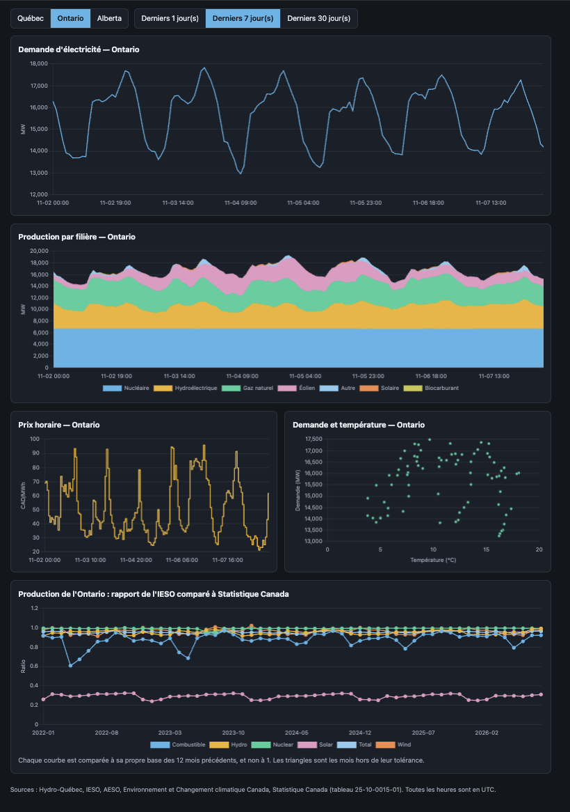
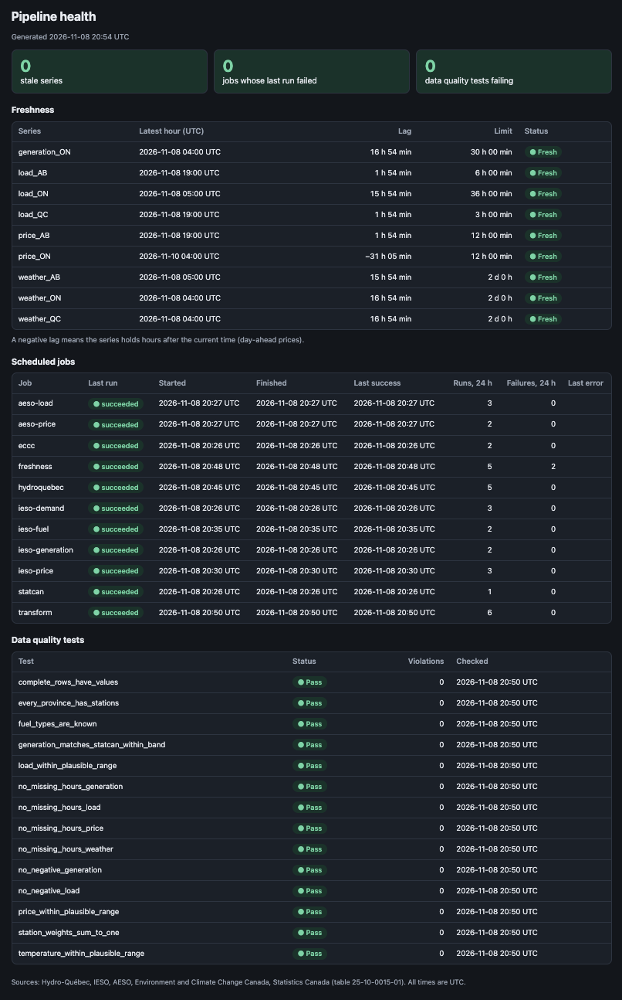

# GridPulse

[English](README.md)

Un pipeline de données sur l'électricité canadienne. Il collecte les données horaires de demande, de production et de prix d'Hydro-Québec, de l'IESO (Ontario) et de l'AESO (Alberta), les croise avec les observations météo d'Environnement et Changement climatique Canada, les compare à Statistique Canada, puis expose un entrepôt testé par une API JSON, un tableau de bord bilingue et une page de santé du pipeline. Écrit en Go.

Ce que le projet démontre :

- **Une ingestion répétable sans risque** : les fichiers bruts vont dans un stockage objet et ne sont jamais modifiés.
- **Un entrepôt testé** : 14 tests SQL de qualité des données s'exécutent après chaque transformation; les résultats sont conservés et affichés sur la page de santé.
- **Une réconciliation** de la production ontarienne avec Statistique Canada, avec des constats documentés, y compris ceux qui ne sont pas encore expliqués (voir [docs/data-notes.md](docs/data-notes.md), en anglais).
- **L'exploitation** : un ordonnanceur avec verrous, délais maximaux et exécutions enregistrées; des limites de fraîcheur par série; une intégration continue avec tests d'intégration; Docker Compose.

[Architecture et schéma](docs/architecture.md) · [Notes sur les données et limites connues](docs/data-notes.md) (en anglais)

## Captures d'écran





## Démarrage rapide

Prérequis : Docker avec Compose. Go (voir `go.mod`) seulement pour compiler ou tester hors des conteneurs.

```sh
cp .env.example .env                      # facultatif : ajouter une clé d'API AESO gratuite pour l'Alberta
docker compose --profile app up -d --build
```

Ouvrir ensuite :

- http://localhost:8080 pour le tableau de bord (français ou anglais, lien `EN`/`FR` dans l'en-tête)
- http://localhost:8080/pipeline pour la fraîcheur, les exécutions et les résultats de tests
- http://localhost:8080/api/v1/health pour l'API

L'ordonnanceur commence à collecter immédiatement. Les séries se remplissent durant la première heure; la demande de l'Ontario ne se met à jour qu'environ une fois par jour, à cause du mode de publication de l'IESO. Pour reconstituer l'historique, voir les exemples d'extraction ci-dessous.

## Travailler sur le code

```sh
docker compose up -d                      # seulement Postgres (:5433) et SeaweedFS (S3 sur :8333)
go test ./...                             # tests unitaires
go test -tags integration ./...           # nécessite aussi les deux services ci-dessus
go build -o bin/loader ./cmd/loader && ./bin/loader -migrate
go run ./cmd/scheduler -list              # tâches et horaires
go run ./cmd/scheduler -once transform    # exécuter une tâche tout de suite
go run ./cmd/api -addr :8080
```

Reconstituer l'historique avec l'extracteur :

```sh
go build -o bin/extractor ./cmd/extractor
./bin/extractor -source hydroquebec
./bin/extractor -source ieso -report Demand -from-year 2025 -to-year 2026
./bin/extractor -source ieso -report GenOutputbyFuelHourly -from-year 2022 -to-year 2026
./bin/extractor -source aeso -report PoolPrice -from 2026-11-01 -to 2026-11-07
./bin/extractor -source eccc -from 2026-11-05 -to 2026-11-06
./bin/extractor -source statcan
./bin/loader -source all                  # charger tout le bronze dans Postgres
```

La configuration passe par des variables d'environnement dont les valeurs par défaut correspondent à `docker-compose.yml` : `GRIDPULSE_S3_ENDPOINT`, `GRIDPULSE_S3_BUCKET`, `GRIDPULSE_S3_ACCESS_KEY`, `GRIDPULSE_S3_SECRET_KEY`, `GRIDPULSE_S3_USE_SSL`, `GRIDPULSE_POSTGRES_DSN`, `GRIDPULSE_AESO_API_KEY`. Un fichier `.env` ignoré par git est chargé automatiquement. L'AESO exige une clé gratuite (developer-apim.aeso.ca); sans elle, les tâches de l'Alberta ne sont pas planifiées.

## Sources de données

| Source | Séries |
|---|---|
| Hydro-Québec | Demande en temps réel (intervalles de 15 minutes, agrégés à l'heure) |
| IESO | Production par filière, demande horaire, prix zonal du lendemain |
| AESO | Prix du pool, charge interne de l'Alberta |
| ECCC | Météo horaire de six stations associées aux trois régions |
| Statistique Canada | Production mensuelle par type, tableau 25-10-0015-01 (sert à la réconciliation) |

Pas encore inclus : les prix en temps réel de l'IESO (5 minutes), des pondérations de stations affinées, les données de contexte de la Régie de l'énergie du Canada. Les données ouvertes d'Hydro-Québec sont sous licence CC BY-NC 4.0; voir [docs/data-notes.md](docs/data-notes.md).

## Licence

Le code est sous licence MIT (voir `LICENSE`). Les données appartiennent à leurs fournisseurs et conservent leurs conditions; celles d'Hydro-Québec sont sous CC BY-NC 4.0.

## Limites

Il s'agit d'un projet de portfolio, non d'un outil d'exploitation ou de négociation : l'API n'a pas d'authentification, les limites de fraîcheur suivent le rythme de publication plutôt qu'un niveau de service, et plusieurs écarts de réconciliation sont mesurés mais non expliqués. Ils sont listés, avec leur statut, dans [docs/data-notes.md](docs/data-notes.md).
