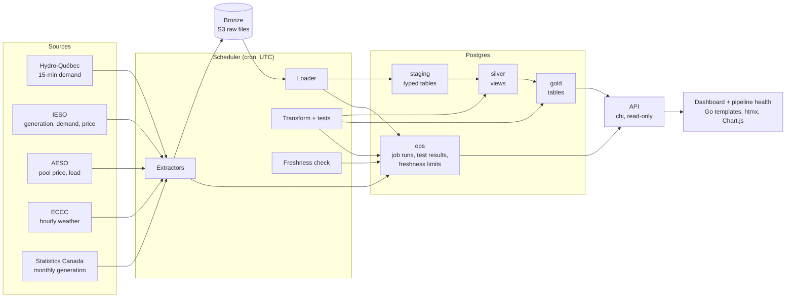

# Architecture

## Layers

| Layer | What it holds | Rules |
|---|---|---|
| bronze | Raw files as downloaded, in an S3 bucket, keyed `source=<name>/date=<YYYY-MM-DD>/<file>` | Never modified. The same upstream version gives the same key, so extraction can be repeated |
| staging | Typed Postgres tables, one per source feed | The loader skips a file whose content hash was already loaded, writes in one transaction per batch, and the newest snapshot wins |
| silver | Views that normalise time to UTC and units | No data of their own |
| gold | Dimensions, hourly facts, a load-weather mart and the monthly reconciliation | Rebuilt whole in one transaction, so readers never see a half-built table |
| ops | Job runs, freshness limits, data quality results, reconciliation tolerances and reviewed months | Written by the scheduler and the transform step |

## Scheduler

All times are UTC. Each job has its own lock (a job never overlaps itself), a timeout, and every run is recorded in `ops.job_run`.

| Job | Schedule |
|---|---|
| hydroquebec | every 15 minutes |
| ieso-demand | minute 20, hourly |
| ieso-generation | minute 25, hourly |
| ieso-price | minute 30, every 2 hours |
| ieso-rtprice | every 5 minutes; re-reads the last 3 delivery hours of the real-time price |
| ieso-rtprice-catchup | minute 17, hourly; re-reads the last 48 hours so a gap (for example after the machine slept) closes by itself |
| ieso-fuel | minute 35, hourly |
| eccc | minute 40, every 6 hours |
| statcan | 12:15 daily |
| aeso-price, aeso-load | minutes 10 and 12, hourly (only when `GRIDPULSE_AESO_API_KEY` is set) |
| transform | every 10 minutes, and only when new data was loaded |
| freshness | minutes 3, 18, 33 and 48 |

Each extract job loads only the keys it has just written. The transform job rebuilds silver and gold, then runs the SQL data quality tests (`sql/tests/`). A test is a query that returns the offending rows, and zero rows means it passes.

## API

Read-only JSON under `/api/v1`, served from a Postgres connection with `default_transaction_read_only=on`. Timestamps are UTC strings; missing values are `null`.

| Endpoint | Returns |
|---|---|
| `/health` | `{"status":"ok"}` when the database answers |
| `/provinces`, `/fuels` | Reference data in English and French |
| `/load`, `/prices`, `/weather`, `/load-weather` | Hourly series for `province` = `QC`, `ON` or `AB`. `/prices` returns one row per hour and `price_kind` (Ontario has a day-ahead and a real-time kind) |
| `/generation` | Hourly generation by fuel (Ontario only) |
| `/reconciliation` | Monthly IESO ÷ StatCan ratios, optional `group` and `status` |
| `/pipeline` | Freshness, latest job runs and latest test results |

Series endpoints take `from` and `to` as UTC dates (inclusive). The default is the last 7 days and the maximum span is 92 days. Answers are wrapped as `{"data": [...], "meta": {...}}`; an empty result is `[]`.

## Dashboard

`/` shows demand, generation by fuel, price, demand against temperature and the Ontario reconciliation. `/pipeline` shows the same health data as the API and refreshes itself every 30 seconds. Both pages work in English and French. Charts are drawn in the browser from the API; htmx and Chart.js are served from the binary, so the pages load nothing from other sites.
